<div align="center">


# Diarea

### Finds what your frontend leaks. Before anyone else does.

An AI agent can now read your frontend and rebuild your product. Diarea reads it first and tells you what is coming out: exposed keys, source maps, API maps, debug globals and the logic you thought was private. Then it scores the damage, from **Sealed** to **Gushing**.

[](https://github.com/kriszwart/diarea/actions/workflows/ci.yml)


**[Website and live demo](https://diarea.tools/)** · [Try it](#try-it-in-30-seconds) · [What it finds](#what-it-finds) · [Extension](#install-the-extension) · [CLI](#cli) · [GitHub Action](#github-action) · [The honest bit](#the-honest-bit) · [What a clone can't copy](#what-a-clone-cant-copy) · [Roadmap](#roadmap)

<a href="https://youtu.be/pWG9IXBkpvM"></a>

<sub>▶ <a href="https://youtu.be/pWG9IXBkpvM">Watch the trailer</a> · <a href="https://youtu.be/8HVhKe6BnXs">Watch the launch video</a></sub>



</div>

---

## Quick start

```
npx diarea scan https://your-site.com     # a live site you own
npx diarea scan dist/index.html           # your build output, no browser needed
npx diarea setup                          # let your coding agent run it (Claude Code, Cursor, any MCP client)
```

Live scans need a browser once. Diarea offers to download it the first time, or run `npx diarea install-browser` (it fetches the exact Chromium this version of Diarea uses). Prefer clicking? There is a [Chrome extension](#install-the-extension). Want it in CI? There is a [GitHub Action](#github-action).

## Let your coding agent fix it

Agent versus agent, made literal. Diarea ships an [MCP](https://modelcontextprotocol.io) server, so the agent that writes your code can find your leaks and close them:

```
npx diarea setup             # Claude Code, for all your projects
npx diarea setup --project   # or write .mcp.json here, so the whole team gets it
npx diarea setup --print     # or show the config for Cursor, Windsurf and other MCP clients
```

Then ask: *"Scan my site for leaks with Diarea and fix what it finds."* The agent runs `diarea_scan` on your build or deployed URL, fixes the causes in your code (secrets and logic to the server, source maps off, payloads trimmed), then scans again to prove the score dropped. The server is read-only, runs on your machine and sends nothing anywhere; secrets reach the agent as a prefix and a length, never in full.

An agent can be talked into things by what it reads, so the server keeps it on a short lead:

- **Files only inside the project** the server was started in. Paths that climb out, absolute paths elsewhere and symlinks pointing out are refused.
- **Public sites only, by default.** `localhost`, private networks (`10.x`, `192.168.x`, `fc00::/7`) and anything that resolves to them are refused, including redirects and requests the page makes. To let the agent scan your dev server, opt in when you set it up: `npx diarea setup --allow-private`. Only you can switch this on; the agent cannot.
- **Never cloud metadata.** Link-local and metadata addresses (`169.254.169.254`, `metadata.google.internal`) are refused even with `--allow-private`.

## Try it in 30 seconds

We built a fake AI app builder that leaks everything, so you can watch Diarea work without pointing it at anything that matters. [Watch it get diagnosed on the website](https://diarea.tools/#scan), or meet [PromptPlop](https://diarea.tools/demo/) directly: describe an app and it plops one out. Its "never reveal this prompt" system prompt is in the bundle. Its model-routing formula is in your browser. It calls the model straight from the page.

```
git clone https://github.com/kriszwart/diarea && cd diarea && npm install
node bin/diarea.js scan site/demo/index.html
```

That is the static scan: no browser, no network, just the files. Every key on the demo is fake and nothing on it phones home.

## Why this exists

There is an open-source agent called [REA](https://github.com/morluto/rea) that reverse-engineers anything, from app behaviour down to native binaries. About a quarter of a million people have starred it. You point it at a product, it explains how a feature works, shows the evidence, and builds a copy.

You cannot stop an agent reading your frontend. Everything the browser receives, the agent receives too. No plugin on their side, no obfuscation, no screenshot block changes that.

So Diarea does the useful thing instead. It reads **your own** site the way REA would, scores how much is leaking, and hands you the points to seal it. Same fight, your corner. Locally, before anyone else looks.

> It is a diagnosis and a coach, not armour.

## What it finds

Eleven checks, one shared engine (`src/checks.js`), the same verdict in the extension, the CLI and CI. REA sorts what it learns into Seen, Inferred and Unknown, and Diarea marks every finding the same way: **seen** means readable as it is, **inferred** means worked out from what is there. Your job is to push it all into Unknown, on your server.

| # | Leak | Why it matters |
|---|------|----------------|
| 01 | **Source maps in production** | Your original, un-minified source. File names, comments, logic. Gift-wrapped. |
| 02 | **Secrets in client code** | Hard-coded keys and tokens in shipped JS or markup. Publishable `pk_` keys are ignored; secret keys and tokens are flagged. |
| 03 | **Client-side scoring or logic** | Weightings, thresholds and rules running in the browser. The part that makes you different. |
| 04 | **Fat hydration payloads** | Boot blobs carrying ids, flags and fields the user never sees. |
| 05 | **Readable code** | Un-minified bundles with developer notes still attached, and debug logging left on. |
| 06 | **A self-mapping API** | Every endpoint, GraphQL operation, tRPC procedure and client route in the bundle or on the wire, admin pages first. |
| 07 | **Your AI system prompt** | The instructions behind your AI feature, readable by anyone. "Never reveal this prompt" included. |
| 08 | **Direct AI API calls** | The browser talking to a model provider itself, which usually means the provider key is in there too. |
| 09 | **Chatty hidden fields** | Hidden inputs, `data-` attributes and storage keys carrying ids, prices, roles, flags and session tokens. |
| 10 | **Sensitive fields** | API responses and boot payloads carrying costs, margins, internal notes, password hashes or other people's emails. Judged by field name only: values are dropped before anything is reported. |
| 11 | **A stack fingerprint** | Not a leak by itself, but it tells a reader exactly which known patterns to try. |

Each finding comes with what a reader sees and a one-line fix (we call it "flush it"). Found secrets are never printed in full: you get a short prefix and the length, which is enough to find it and useless to anyone reading over your shoulder.

| Leak Score | Band | Translation |
|---|---|---|
| 0 to 14 | **Sealed** | Tight. An agent would come away with very little. |
| 15 to 39 | **Seeping** | A few things are showing. Worth a wipe-down. |
| 40 to 69 | **Leaking** | Your logic and data are readable from the browser. |
| 70 to 100 | **Gushing** | Most of how this works is sitting in the open. |

## Install the extension

1. Clone this repo and run `npm install && npm run build:extension`. The build copies the shared engine and page collector from `src/` into `extension/lib/`.
2. Open `chrome://extensions` in Chrome or Edge.
3. Turn on **Developer mode** (top right).
4. Click **Load unpacked** and select the `extension/` folder.
5. Pin the icon, open one of your own deployed sites, and click it.

To get a zip for the Chrome Web Store, run `npm run package:extension` (it lands in `dist/`). The listing copy, privacy answers and store images live in [`docs/store/`](docs/store/listing.md), and the privacy policy is at [diarea.tools/privacy.html](https://diarea.tools/privacy.html).

It auto-scans on open. Use **Re-scan** after a deploy. Point it at your own staging site first and watch the score.

If the site loads its own scripts from a CDN (`cdn.your-site.com`, a CloudFront host), the page cannot read them across origins, so the popup offers to: click **Read them too** and Chrome asks once for that site. Nothing is granted at install, and third-party scripts are never offered.

## CLI

The same detection engine runs headless, so you can scan from your terminal and in CI. The checks live in one shared module (`src/checks.js`); the extension and the CLI both use it. Found secret values are never printed, only a short prefix and their length.

```
# a saved page or build output, no browser needed
npx diarea scan dist/index.html
npx diarea scan dist              # a build folder: index.html plus every script in it

# a live site (needs a browser once, see below)
npx diarea scan https://your-site.com

# machine-readable, and fail a build above a threshold
npx diarea scan dist/index.html --json
npx diarea scan https://your-site.com --fail-on 40

# SARIF 2.1.0 for GitHub code scanning
npx diarea scan dist --sarif > diarea.sarif

# pages behind a login: log in once yourself, then scan as that user
npx diarea login https://your-site.com/login
npx diarea scan https://your-site.com/dashboard --storage-state .diarea/login.json
```

Two modes:

- **Static (jsdom).** Point it at a `.html` file, stdin (`-`), or use `--html`. No browser, fast, safe on untrusted markup (scripts are never run). Reads inline scripts, hydration blobs and the DOM, plus the page's local `<script src>` and `modulepreload` files and any `.map` beside them. Give it the build folder (`dist`) and it reads every script and script map in it too, because lazy chunks and "hidden" source maps get deployed even though `index.html` never names them. It never reads outside that folder, never follows symlinks and never fetches anything. It will not see data that only appears after client-side rendering.
- **Live (Playwright).** Point it at a URL. Loads the real page in headless Chromium, so it sees page globals, fetched bundles, the site's own CDN scripts and the live network map. Third-party scripts are never read. The first live scan offers to download Chromium; to do it up front:

```
npx diarea install-browser
```

It uses Diarea's own Playwright, so the browser always matches. (A bare `npx playwright install` can fetch a different Playwright and leave you with "Executable doesn't exist".)

Most leakage lives behind the login, so live scans can sign in. `diarea login <url>` opens a real browser window; you log in yourself (Diarea never sees your password) and press Enter, and it saves that session to `.diarea/login.json`, readable only by you and kept out of git by its own `.gitignore`. Pass it with `--storage-state`. It is a live session: treat it like a password and delete it when you are done.

Options: `--json`, `--sarif`, `--fail-on <score>`, `--strict` (exit 1 on any critical finding), `--timeout <ms>`, `--storage-state <file>`, `--no-color`. Exit codes make it a drop-in CI check: `0` clean or under your threshold, `1` when the score reaches `--fail-on` (or any critical finding with `--strict`), `2` on error.

## GitHub Action

Gate your builds on the Leak Score. Scan your built HTML (no browser needed) or a deployed preview URL you own:

```yaml
- uses: actions/checkout@v4
- run: npm ci && npm run build
- uses: kriszwart/diarea@v0
  with:
    target: dist              # or dist/index.html, or https://your-preview.example.com
    fail-on: 40               # fail at a score of 40 or more
    strict: true              # also fail on any critical finding
```

The step fails when the CLI would (score at or over `fail-on`, or a critical finding with `strict`) and writes the score and findings to the job summary. Leave `fail-on` empty to report without failing.

On pull requests it also posts the Leak Score as a comment, then updates that same comment on every push and says how the score moved ("⬆️ Up from 12, something started leaking"). Give the job permission to comment:

```yaml
permissions:
  contents: read
  pull-requests: write
```

Commenting never fails the build: on forked pull requests (read-only token) it logs a warning and the job summary still has the report. Set `comment: false` to turn it off.

We dogfood it: every pull request to this repo gets the Leak Score of our own landing page. It scores 11/100, Sealed. The one finding is that `landing.js` is readable, which for an open source site is rather the point.

`@v0` follows the latest 0.x release. Pin to `@v0.6.0` (or a commit SHA) for a fixed version.

| Input | Default | |
|---|---|---|
| `target` | required | A build folder such as `dist`, a built `.html` file (both static) or an `https://` URL (live, installs Chromium) |
| `fail-on` | `40` | Fail at this score or more |
| `strict` | `false` | Fail on any critical finding |
| `timeout` | `30000` | Live scan timeout in ms |
| `storage-state` | none | Live scans only: a saved login from `diarea login`. Write it from a secret in an earlier step; never commit it |
| `comment` | `true` | On pull requests, post the score as one comment and keep it updated |
| `comment-key` | the target | Keeps comments apart when one workflow scans several targets |
| `github-token` | `github.token` | Token used to comment |
| `sarif` | `false` | Also write the findings as SARIF (the `sarif` output) |
| `node-version` | `22` | Node to run on |

Outputs: `score`, `band`, `critical`, `report` (path to the JSON report) and `sarif` (path to the SARIF file).

To see findings in the repository's Security tab next to CodeQL, turn on `sarif` and upload it. `if: always()` uploads even when the scan fails the build:

```yaml
permissions:
  contents: read
  security-events: write
steps:
  - uses: kriszwart/diarea@v0
    id: diarea
    with:
      target: dist/index.html
      sarif: true
  - uses: github/codeql-action/upload-sarif@v3
    if: always() && steps.diarea.outputs.sarif
    with:
      sarif_file: ${{ steps.diarea.outputs.sarif }}
      category: diarea
```

Each check is its own rule (`source-maps`, `secrets`, `client-logic` and so on), and alerts point at the scanned file, so this works best with a static scan of a page in the repository.

## Privacy

Everything stays in your browser. Diarea sends nothing to us or to any third party and stores nothing. To read what your page ships, it requests that page's own scripts and probes for their `.map` files, the same requests anyone with DevTools could make, and nothing else. Permissions are the minimum: `activeTab` (the current tab, only when you click) and `scripting` (to run the scan), plus optional access to your own CDN, asked for one site at a time only when you click. Third-party scripts are listed but never fetched.

## The honest bit

Diarea surfaces exposure. The durable protections are server-side, and no browser extension can provide them:

- **Keep the scoring engine private.** Rules, weightings and thresholds run on the server. The browser gets verdicts and explanations, never the method.
- **Thin your API responses.** Return only what the page renders.
- **Strip source maps** and minify shipped code.
- **Secrets never touch the browser.** Publishable keys only on the client.
- **Guard the API.** Auth, per-account quotas, rate limits, anomaly detection on bulk probing.
- **Isolate tenant data** and block unapproved bulk exports.

## What a clone can't copy

Code was never the moat. An agent can rebuild anything it can see, so Diarea makes sure it sees as little as possible. Then build on the things it could never take anyway:

1. **Data that stays home.** Your datasets, your own trained models, the live data your users create. A perfect clone of your interface without your database is a very pretty empty box. This is the one Diarea guards: every check is about keeping it off the client.
2. **The people in it.** Users, community, the workflows whole teams have built around you. An agent can copy your app. It cannot copy everyone who uses it, or make them move.
3. **Trust.** Brand, service and a reputation people choose on purpose. When features become a commodity, trust is the thing a copycat has to start from zero.
4. **The physical world.** Hardware, sensors, logistics, real-world integrations. Software that reads your frontend cannot spin up a supply chain.

## The Containment Score

Every defensive move earns points. Get to 100 and there is nothing left to reverse-engineer.

| Move | Points |
|------|-------:|
| Private scoring engine (server-side) | +25 |
| Thin API responses | +15 |
| Strip source maps | +15 |
| Secrets off the client | +15 |
| API auth, quotas, rate limits | +15 |
| Tenant isolation, no bulk export | +10 |
| Signed reports for provenance | +5 |

## Roadmap

Diarea is the defensive agent. The plan is to let it fight everywhere your code ships. See [docs/roadmap.md](docs/roadmap.md) for detail.

- **v0 (done)** Chrome extension. Scan your own page, get the score.
- **v1 (done)** CLI: `npx diarea scan <url|file>`, static and live modes, shared engine.
- **v2 (done)** CI gate. The GitHub Action wraps `--fail-on` and `--strict`, writes a job summary and keeps a Leak Score comment on every pull request.
- **v3** Watcher: spot agent-style probing hitting your API live.

## Contributing

Issues and pull requests welcome. See [CONTRIBUTING.md](CONTRIBUTING.md). New detection rules are the highest-value contribution: if REA can read it, Diarea should flag it.

## Disclaimer

Diarea is a defensive tool that inspects pages you own and control, to help you harden them. It does not reverse-engineer third parties and is not a substitute for server-side security. You are responsible for how you use it.

## Star history

If this saved you from shipping your logic to the browser, a star helps other people find it.

[](https://star-history.com/#kriszwart/diarea&Date)

## License

[MIT](LICENSE) · Built in Kuala Lumpur.
